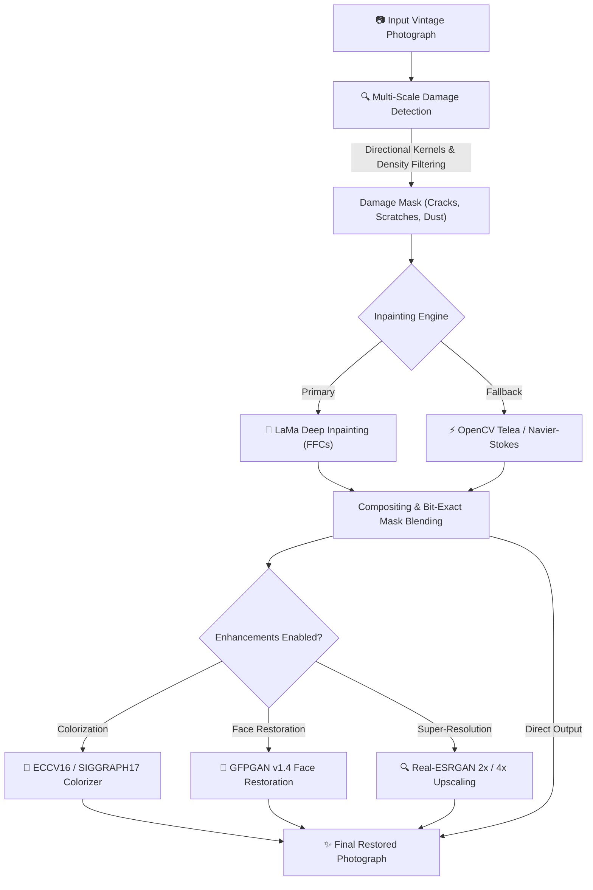

# 🕰️ Old Photograph Restoration and Enhancement

[](https://www.python.org/)
[](https://streamlit.io/)
[](https://pytorch.org/)
[](https://opencv.org/)
[](LICENSE)

An enterprise-grade, end-to-end AI and Computer Vision pipeline engineered to restore degraded, faded, scratched, cracked, and monochrome vintage photographs. Combines classical computer vision algorithms with state-of-the-art deep learning architectures (LaMa, GFPGAN, Real-ESRGAN, and Zhang et al. Colorizers) with seamless CPU fallback and 100% bit-exact preservation of undamaged photographic details.

---

## 🌟 Key Features

- **Precision Damage Detection (Multi-Detector)**:
  - 8-angle directional line morphology ($0^\circ$ to $157.5^\circ$) to identify deep diagonal scratches, vertical creases, and paper tears.
  - Local density texture filtering ($31\times31$) to prevent mistaking clothing fabrics, tweed, floral prints, or curtains for damage.
  - Facial landmark protection to shield eyes, nose, and mouth contours.
  - Live damage mask preview with vibrant red highlighting and defect area calculations.
  - Interactive manual brush tool to fine-tune damage selections.

- **Deep Learning Inpainting (Samsung AI LaMa)**:
  - Resolution-robust Large Mask Inpainting using Fast Fourier Convolutions (FFCs) to naturally fill large cracks, folds, stains, and missing regions.
  - Seamless fallback to OpenCV Navier-Stokes and Telea Fast Marching inpainting.
  - Localized compositing with edge feathering: guarantees 100% bit-exact preservation of original pixels outside the damage mask.

- **Blind Face Restoration (Tencent ARC GFPGAN v1.4)**:
  - Generative Facial Prior GAN reconstructs severe facial degradation, recovering eyes, pupils, expressions, and natural skin texture.
  - Configurable fidelity weight ($0.0$ to $1.0$) and face blending ratio to prevent artificial or over-smoothed appearances.
  - Multi-face detection with close-up before-and-after inspection zooms.

- **AI Super-Resolution (Real-ESRGAN 2× & 4×)**:
  - High-fidelity super-resolution with official `RealESRGAN_x2plus` and `RealESRGAN_x4plus` models.
  - Memory-safe tiled inference (`tile=400`) prevents out-of-memory errors on standard CPU hardware.

- **Historical Black-and-White Colorization (ECCV16 & SIGGRAPH17)**:
  - Deep neural colorization operating in CIELAB color space.
  - Fuses predicted chromaticity ($a^*, b^*$) with native high-resolution lightness ($L^*$) to retain 100% of photographic sharpness.
  - Dual modes: ECCV 2016 (vibrant artistic tones) and SIGGRAPH 2017 (subtle natural tones).

- **Interactive Streamlit Web Dashboard**:
  - Dark-themed responsive UI with real-time hardware status indicators.
  - 4-step workflow: Upload $\rightarrow$ Inspect Damage $\rightarrow$ Restore Photograph $\rightarrow$ Compare & Download.
  - 3-panel side-by-side inspection (Original | Damage Mask | Restored).
  - Pixel Modification Verification Heatmap proving defects were genuinely repaired.

---

## 🏗️ Pipeline Architecture



---

## 📁 Repository Structure

```
Old-Photograph-Restoration/
├── app.py                      # Main Streamlit web application
├── requirements.txt            # Python dependencies
├── .gitignore                  # Git ignore rules (excludes models & private data)
├── README.md                   # Comprehensive documentation
│
├── modules/                    # Core restoration algorithms
│   ├── __init__.py
│   ├── opencv_restoration.py   # Denoising, multi-detector, CLAHE, USM, & fallback inpainting
│   ├── lama_inpainting.py      # Samsung AI LaMa deep inpainting engine
│   ├── face_restoration.py     # GFPGAN v1.4 face restoration engine
│   ├── super_resolution.py    # Real-ESRGAN 2x & 4x super-resolution engine
│   └── colorization.py        # ECCV16 & SIGGRAPH17 colorization engines
│
├── utils/                      # Helper utilities
│   ├── __init__.py
│   ├── image_io.py             # Format validation, loading, saving & conversions
│   └── model_downloader.py     # CLI & automated weights downloader
│
├── models/                     # Model weights directory (git-ignored)
│   └── pretrained/
│       └── .gitkeep
│
├── gfpgan/                     # GFPGAN weights directory (git-ignored)
│   └── weights/
│       └── .gitkeep
│
├── test_samples/               # Public benchmark sample photographs
│   ├── sample_damaged.png      # Synthetic damaged sample (scratches & grain)
│   ├── sample_vintage_portrait.jpg # Authentic degraded portrait (GFPGAN benchmark)
│   └── sample_bw_vintage.png   # Monochrome vintage portrait
│
├── uploads/                    # User uploaded images (.gitkeep tracked)
├── outputs/                    # Exported restorations (.gitkeep tracked)
│
└── tests/                      # Automated pytest and benchmark test suites
    ├── test_app_pipeline.py    # Complete 4-stage integrated pipeline test
    ├── test_opencv_restoration.py # Classical CV filters & inpainting tests
    ├── test_lama_inpainting.py # LaMa neural network verification
    ├── test_face_restoration.py# GFPGAN face restoration unit test
    ├── test_super_resolution.py# Real-ESRGAN 2x/4x scaling test
    ├── test_colorization.py    # Colorization verification test
    └── test_quality_restoration.py # Restoration benchmark suite
```

---

## 📦 Model Weights Guide

To keep the repository lightweight and adhere to GitHub's 100 MB file size limit, deep learning model checkpoints are **not committed to Git**.

### 1. Automated Model Download (Recommended)

Run the built-in downloader to automatically fetch all pretrained weights:

```bash
python utils/model_downloader.py --all
```

To download an individual model:

```bash
python utils/model_downloader.py --model big_lama
python utils/model_downloader.py --model gfpgan_v1.4
python utils/model_downloader.py --model realesrgan_x2plus
```

To inspect cache status:

```bash
python utils/model_downloader.py --list
```

### 2. Manual Download Links

If you prefer downloading manually, place each file in its corresponding directory:

| Model | File Name | Size | Target Directory | Official Source |
| :--- | :--- | :--- | :--- | :--- |
| **LaMa Inpainting** | `big-lama.pt` | ~196 MB | `models/pretrained/` | [Download](https://github.com/enesmsvn/simple-lama-inpainting/releases/download/v0.1.0/big-lama.pt) |
| **GFPGAN v1.4** | `GFPGANv1.4.pth` | ~332 MB | `models/pretrained/` | [Download](https://github.com/TencentARC/GFPGAN/releases/download/v1.3.0/GFPGANv1.4.pth) |
| **Real-ESRGAN 2×** | `RealESRGAN_x2plus.pth` | ~64 MB | `models/pretrained/` | [Download](https://github.com/xinntao/Real-ESRGAN/releases/download/v0.2.1/RealESRGAN_x2plus.pth) |
| **Real-ESRGAN 4×** | `RealESRGAN_x4plus.pth` | ~64 MB | `models/pretrained/` | [Download](https://github.com/xinntao/Real-ESRGAN/releases/download/v0.1.0/RealESRGAN_x4plus.pth) |
| **ECCV 2016 Color** | `colorization_release_v2-9b330a0b.pth` | ~129 MB | `models/pretrained/` | [Download](https://colorizers.s3.us-east-2.amazonaws.com/colorization_release_v2-9b330a0b.pth) |
| **SIGGRAPH 2017 Color** | `siggraph17-df00044c.pth` | ~138 MB | `models/pretrained/` | [Download](https://colorizers.s3.us-east-2.amazonaws.com/siggraph17-df00044c.pth) |
| **Face Detection** | `detection_Resnet50_Final.pth` | ~104 MB | `gfpgan/weights/` | [Download](https://github.com/xinntao/facexlib/releases/download/v0.1.0/detection_Resnet50_Final.pth) |
| **Face Parsing** | `parsing_parsenet.pth` | ~81 MB | `gfpgan/weights/` | [Download](https://github.com/xinntao/facexlib/releases/download/v0.2.2/parsing_parsenet.pth) |

---

## 🚀 Installation & Setup

### Prerequisites

- **Python**: 3.10 or 3.11 (64-bit recommended)
- **OS**: Windows 10/11, macOS, or Linux
- **Hardware**: Compatible with standard multi-core CPUs; NVIDIA CUDA GPU optional for faster inference.

### 1. Clone the Repository

```bash
git clone https://github.com/Dipak-Jha-2004/Old-Photograph-Restoration.git
cd Old-Photograph-Restoration
```

### 2. Create and Activate Virtual Environment

**Windows (PowerShell):**
```powershell
python -m venv .venv
.\.venv\Scripts\Activate.ps1
```

**Linux / macOS:**
```bash
python3 -m venv .venv
source .venv/bin/activate
```

### 3. Install Dependencies

```bash
pip install --upgrade pip
pip install -r requirements.txt
```

### 4. Download Pretrained Models

```bash
python utils/model_downloader.py --all
```

---

## 💻 Running the Application

Launch the interactive Streamlit dashboard:

```bash
streamlit run app.py
```

The application will open in your default browser at `http://localhost:8501`.

### User Workflow
1. **Upload Photograph**: Drag and drop any `.jpg`, `.jpeg`, or `.png` vintage photograph (or click one of the quick test sample buttons).
2. **Review Damage Detection**: Inspect the live red overlay highlighting cracks and scratches. Adjust sensitivity or protect facial features as needed.
3. **Click "⚡ Restore Photograph"**: Triggers deep inpainting and optional enhancements.
4. **Compare & Download**: View the 3-panel inspection (Original | Mask | Restored), examine facial close-ups and difference heatmaps, and download the restored photograph in PNG or JPG format.

---

## 🧪 Running Automated Tests

Run the complete test suite using `pytest`:

```bash
# Run all tests with detailed verbosity
pytest -v

# Run integrated pipeline verification
pytest test_app_pipeline.py -v

# Run individual module tests
python test_opencv_restoration.py
python test_lama_inpainting.py
python test_face_restoration.py
python test_super_resolution.py
python test_colorization.py
```

---

## 📜 Citations and Acknowledgments

- **LaMa (Resolution-robust Large Mask Inpainting)**: Roman Suvorov et al., *Resolution-robust Large Mask Inpainting with Fourier Convolutions*, WACV 2022.
- **GFPGAN**: Xintao Wang et al., *Towards Real-World Blind Face Restoration with Generative Facial Prior*, CVPR 2021.
- **Real-ESRGAN**: Xintao Wang et al., *Real-ESRGAN: Training Real-World Blind Super-Resolution with Pure Synthetic Data*, ICCVW 2021.
- **Colorful Image Colorization**: Richard Zhang, Phillip Isola, Alexei A. Efros, *Colorful Image Colorization*, ECCV 2016 & SIGGRAPH 2017.

---

## 📄 License

This project is licensed under the MIT License. See the [LICENSE](LICENSE) file for details.
